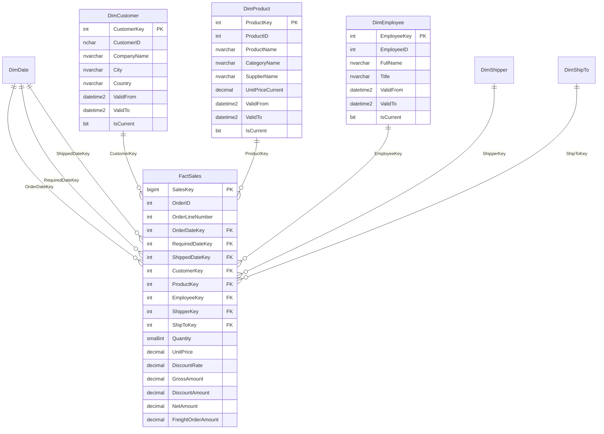

# NorthWindDW — modelo estrella

## 1. Objetivo
Transformar la base operacional `NorthWind` en un almacén dimensional `NorthWindDW` para analizar ventas históricas en SQL Server. El esquema de origen del archivo `NorthWind.sql` contiene, entre otras, las tablas `Orders`, `OrderDetails`, `Customers`, `Products`, `Categories`, `Suppliers`, `Employees` y `Shippers`.

## 2. Grano de la tabla de hechos
**Una fila de `FactSales` representa una línea de un pedido**, identificada en NorthWind por la combinación `OrderID + ProductID`. Es importante fijar el grano antes de elegir medidas: evita mezclar totales de cabecera con importes de detalle.

## 3. Diagrama final

## 4. Objetos incluidos

| Objeto | Función |
|---|---|
| `DimDate` | Calendario para fecha del pedido, fecha requerida y fecha de envío. |
| `DimCustomer` | Datos descriptivos del cliente, incluyendo ubicación y contacto. SCD tipo 2. |
| `DimProduct` | Producto con categoría y datos seleccionados del proveedor en la misma tabla. SCD tipo 2. |
| `DimEmployee` | Vendedor/empleado responsable del pedido. SCD tipo 2. |
| `DimShipper` | Empresa transportista. La versión inicial usa atributos actuales; se puede extender a SCD2 si el requisito histórico lo exige. |
| `DimShipTo` | Dirección de entrega tomada de la cabecera del pedido. Se conserva como combinación de destino. |
| `FactSales` | Medidas de venta y claves hacia las dimensiones. |

## 5. Razones del diseño y selección de campos

### Paso 1 — Separar OLTP y OLAP
`NorthWind` sigue siendo el origen transaccional. `NorthWindDW` será el almacén de análisis. Separarlos evita que las consultas analíticas compitan con las operaciones de ventas y permite adaptar las estructuras al análisis.

### Paso 2 — Elegir el proceso de negocio
Se eligió **ventas de pedidos** porque `Orders` contiene contexto del pedido y `OrderDetails` contiene el producto, cantidad, precio y descuento de cada línea.

### Paso 3 — Definir el grano
El grano es una línea de pedido. La clave de negocio de origen es `(OrderID, ProductID)` y se conserva como restricción única en la tabla de hechos. `SalesKey` es la llave subrogada técnica de la fila del hecho; `OrderID` se mantiene como dimensión degenerada para filtrar y rastrear pedidos sin crear una dimensión de pedido solo para ese identificador.

### Paso 4 — Elegir las medidas
- `Quantity`: unidades vendidas.
- `UnitPrice`: precio unitario registrado en el detalle del pedido.
- `DiscountRate`: descuento de origen convertido a decimal entre 0 y 1.
- `GrossAmount = Quantity × UnitPrice`.
- `DiscountAmount = Quantity × UnitPrice × DiscountRate`.
- `NetAmount = GrossAmount − DiscountAmount`.
- `FreightOrderAmount`: flete guardado a nivel de pedido. Como el flete de cabecera se repite en cada línea asociada, **no se debe sumar directamente** sobre `FactSales`. Para análisis aditivo del flete se debe asignar el flete a las líneas, por ejemplo proporcionalmente al importe bruto, con una regla ETL documentada.

### Paso 5 — Elegir las dimensiones
- **Fecha:** se usan tres roles de la misma dimensión (`OrderDateKey`, `RequiredDateKey`, `ShippedDateKey`) para estudiar cuándo se pidió, cuándo se requería y cuándo se envió.
- **Cliente:** `Customers` aporta identificador, empresa, contacto y ubicación.
- **Producto:** `Products` aporta nombre, unidad, precio actual y estado; `Categories` aporta categoría; `Suppliers` aporta nombre y ubicación del proveedor. Estos atributos se juntan en `DimProduct`, evitando dimensiones normalizadas separadas para categoría y proveedor.
- **Empleado:** `Employees` aporta el responsable del pedido y sus atributos descriptivos.
- **Transportista:** `Shippers` identifica quién envía el pedido.
- **Destino de envío:** los campos `ShipName`, `ShipAddress`, `ShipCity`, `ShipRegion`, `ShipPostalCode` y `ShipCountry` de `Orders` se agrupan en `DimShipTo`, pues el destino puede ser distinto de la dirección registrada del cliente.

### Paso 6 — Llaves subrogadas
Las dimensiones usan claves numéricas internas (`CustomerKey`, `ProductKey`, `EmployeeKey`, etc.) distintas de los identificadores operacionales. Esto permite conservar varias versiones de una misma entidad sin modificar hechos históricos. `CustomerID`, `ProductID` y `EmployeeID` se mantienen como claves naturales para relacionar cada versión con el sistema fuente.

### Paso 7 — SCD tipo 2
En `DimCustomer`, `DimProduct` y `DimEmployee` se incluyeron:
- `ValidFrom`: inicio de vigencia de esa versión.
- `ValidTo`: fin de vigencia.
- `IsCurrent`: identifica la versión vigente.
- llave subrogada `IDENTITY`: identifica cada versión de manera única.

Cuando cambia un atributo que se quiere historizar, el ETL cierra la versión vigente (`IsCurrent = 0`, `ValidTo = fecha del cambio`) e inserta una nueva versión con nueva llave subrogada. Los hechos nuevos deben apuntar a la versión válida en la fecha del evento, no siempre a la versión actual. El archivo `10_Ejemplo_SCD_Tipo2_Cliente.sql` ilustra el patrón para cliente; debe adaptarse y validarse para producción, y repetirse para producto y empleado según las reglas de negocio.

### Paso 8 — Fechas desconocidas y calidad
`DimDate` reserva `DateKey = 0` para fechas desconocidas. El proceso de carga inicial crea las fechas que aparecen en los pedidos. Para un almacén productivo conviene poblar un calendario completo para todos los días del rango analítico y usar miembros “desconocido/no aplica” en dimensiones si la fuente permite claves nulas.

### Paso 9 — Carga y validación
Ejecutar los scripts en el orden indicado abajo. Verificar recuentos, importes agregados, claves huérfanas y duplicados de `(OrderID, OrderLineNumber)`. Las cargas incluidas son una **carga inicial de ejemplo**; un proceso ETL incremental real debe gestionar altas, cambios, bajas lógicas, reprocesos y selección de versión SCD histórica.

## 6. Orden de ejecución

1. `00_Crear_Base_Datos.sql`
2. `01_DimDate.sql`
3. `02_DimCustomer.sql`
4. `03_DimProduct.sql`
5. `04_DimEmployee.sql`
6. `05_DimShipper.sql`
7. `06_DimShipTo.sql`
8. `07_FactSales.sql`
9. `08_Cargar_Dimensiones_Inicial.sql`
10. `09_Cargar_FactSales_Inicial.sql`
11. `11_Consultas_Verificacion.sql`

`10_Ejemplo_SCD_Tipo2_Cliente.sql` es una plantilla explicativa y se ejecuta solo al probar cambios SCD2, no como parte de la carga inicial normal.

## 7. Consideraciones y limitaciones
- Los scripts de carga presuponen que la base fuente se llama `NorthWind`, está en la misma instancia SQL Server y usa el esquema `dbo`.
- Los scripts de creación son idempotentes respecto a la existencia de las tablas, pero las cargas iniciales no son un framework ETL completo.
- `OrderDetails.Discount` en NorthWind suele almacenarse como proporción decimal (por ejemplo, `0.10` equivale al 10%). Confirma este formato en los datos antes de cargar.
- El flete se conserva como dato de cabecera y no debe sumarse a través de las líneas sin asignación.
- `OrderLineNumber` contiene `ProductID`, porque el esquema NorthWind estándar identifica el detalle con `OrderID + ProductID`; no representa necesariamente el orden visual de la línea.
- No se copian imágenes ni textos largos no analíticos (`Picture`, `Photo`, `Notes`, etc.) porque no contribuyen a las medidas principales de ventas. Se pueden añadir si existe un caso de uso.
- Antes de usar en producción, ajustar tipos y reglas de retención según los requisitos reales.
